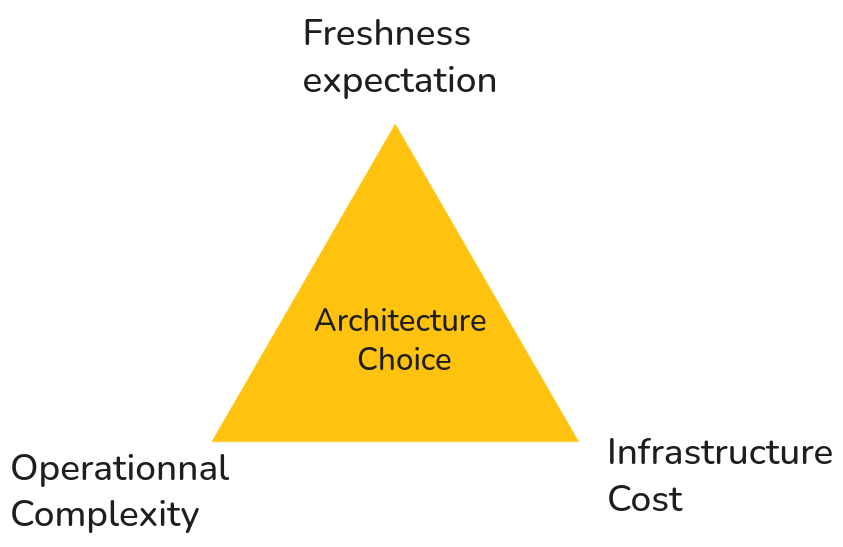
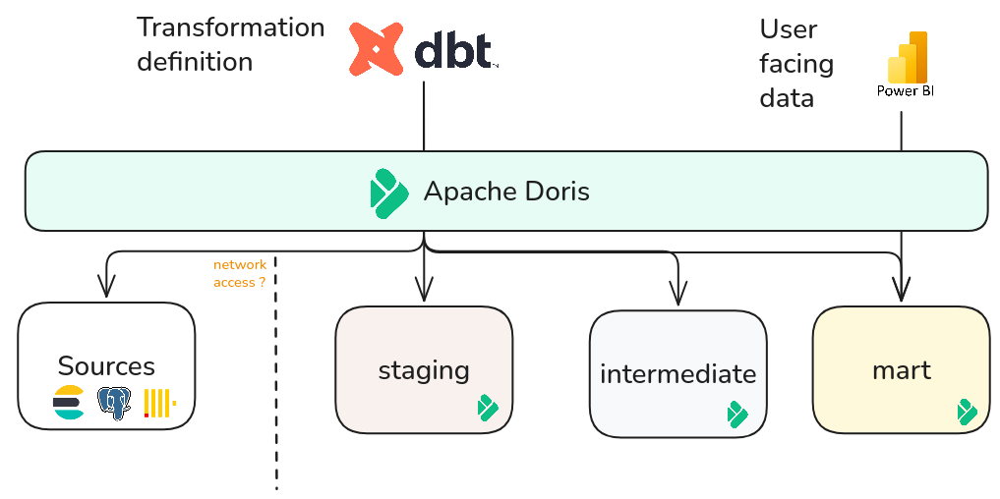
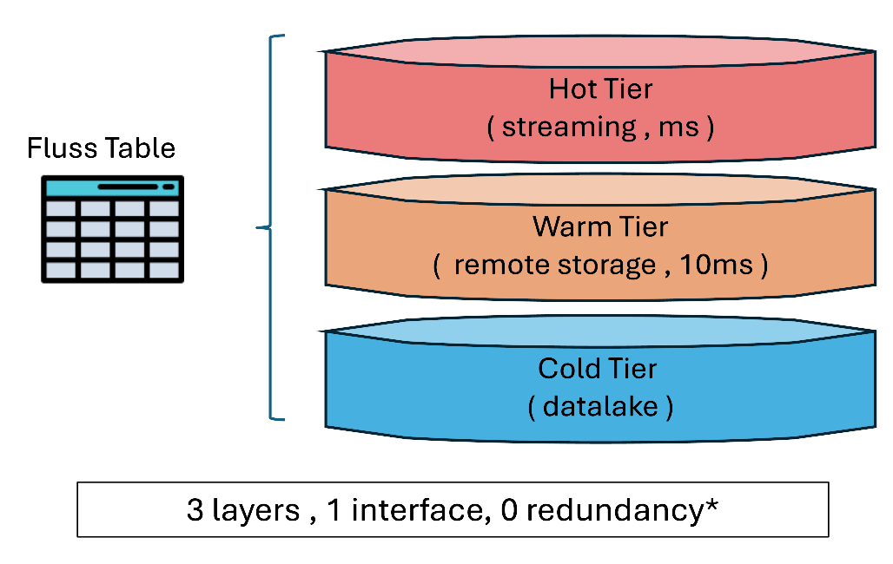
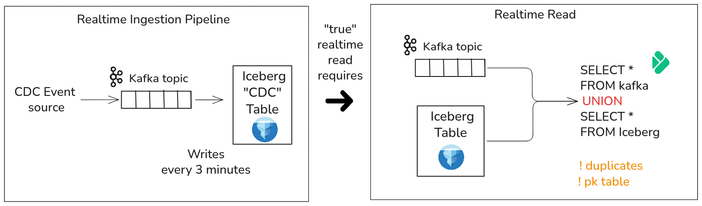
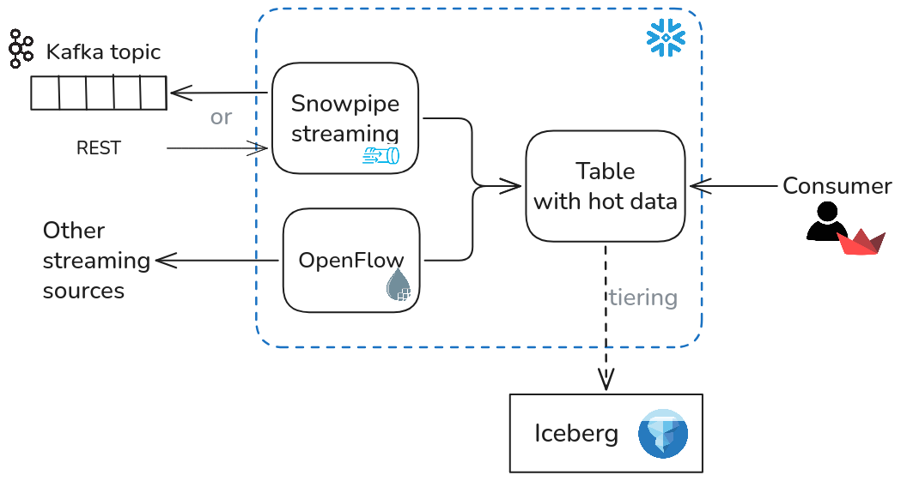
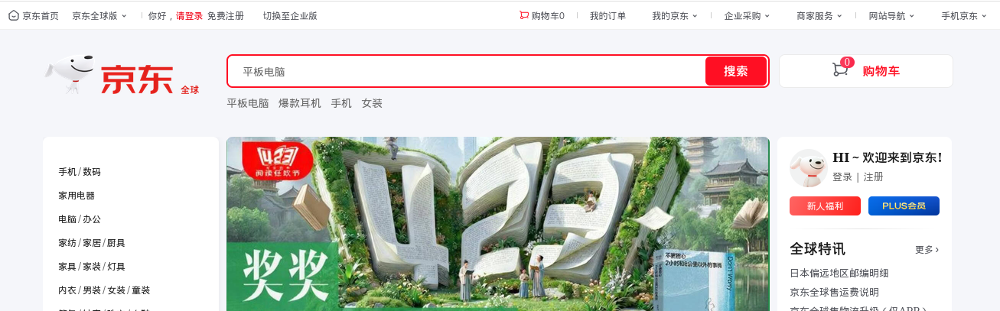
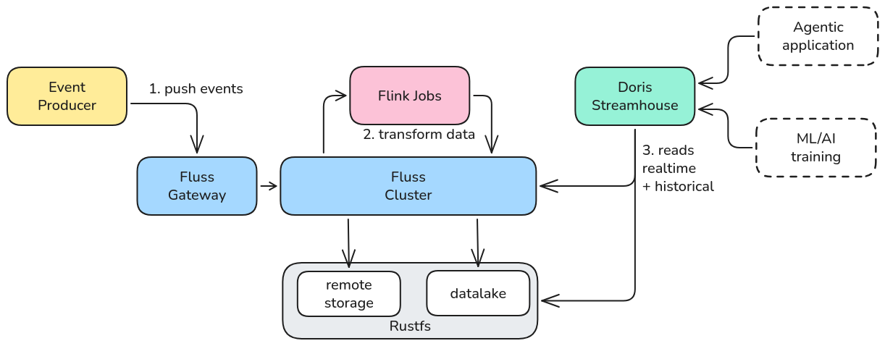
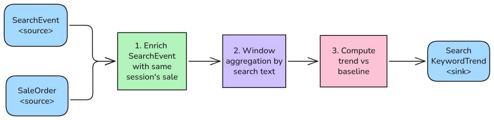
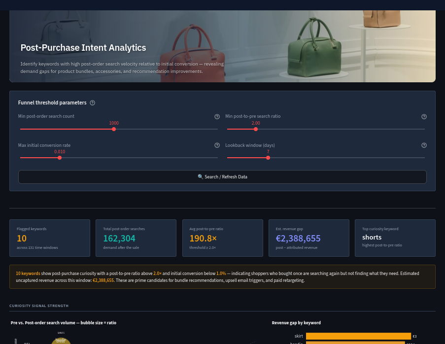
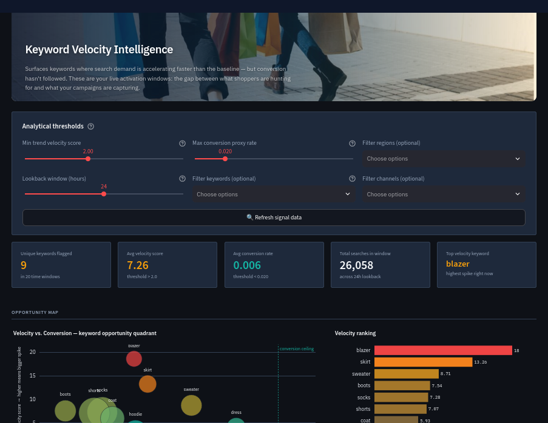

# When Freshness Matters : Real-Time Analytics with Apache Fluss and Apache Doris

Analytical needs are increasingly shifting toward the immediate exploitation of data. But what implications does this freshness requirement have on the way data architectures are designed, from ingestion to consumption?

With its version 5.0 and its Multi-Modal Lakehouse approach, Apache Doris notably introduces an integration with Apache Fluss, opening new perspectives for real-time analytics.

Why is real-time becoming a key concern for analytical architectures? What use cases justify this evolution, and how does the combination of Apache Fluss and Apache Doris address them?

This repository provides a local deployment guide illustrated through a practical use case of trend detection in e-commerce searches

<figure align="center">

</figure>

**Repository structure**

|Application| Folder|
|---|---|
|local deployment files |  [doris-setup](docker-setup) |
|Fake Data Generator| [generate-fake-data](etl/generate-fake-data) |
|Mart Search Keyword Trend | [mart-search-keyword-trend](etl/mart-search-keyword-trend) |
|Dashboard Application | [dashboard-search_keyword-trend](data-visualization/dashboard-search-keyword-trend) |
|Flink SQL Sender | [send-sql-to-flink](tools/send-sql-to-flink) |

**Detailed outline**

1. [Why is real-time becoming a key concern for analytical architectures?](#why-is-real-time-becoming-a-key-concern-for-analytical-architectures)
    1. [How can one hour of data freshness be too late?](#how-can-one-hour-of-data-freshness-be-too-late)
    2. [Micro-batch vs streaming: how to decide?](#micro-batch-vs-streaming-how-to-decide)
2. [Toward a Real-Time Analytics architecture with Apache Fluss and Apache Doris](#why-is-the-combination-of-apache-fluss-and-apache-doris-ideal-for-real-time-analytics)
    1. [Apache Doris: open analytic database](#apache-doris-an-analytic-database-built-for-openness)
    2. [Apache Fluss: optimized streaming layer](#apache-fluss-a-storage-system-oriented-toward-streaming-analytics)
    3. [The Fluss-Doris integration: toward a unified analytical experience](#a-combination-for-an-optimized-and-simplified-union-read)
    4. [Architectural positioning and comparison with alternatives](#comparison-with-other-implementations)
3. [Use case: Search Text Trend](#example-use-case-search-text-trend)
    1. [Implementation description](#architecture)
    2. [Data Transformation](#data-transformation)
    3. [Visualization](#visualization)
4. [Outlook and agentic perspectives](#outlook-and-agentic-perspectives)
5. [References](#references)

## Why is real-time becoming a key concern for analytical architectures?

> What is the real value of freshness? As Real-time by definition always implies latency.

The key point here is that streaming is not done for the sake of streaming. The need must be justified both technically and economically.

### How can one hour of data freshness be too late?

Three questions help frame the need:

- **What is the data used for?** Does it trigger an immediate action or feed a report?
- **Is the action window ephemeral?** Can we wait an hour, or until the next day?
- **What level of freshness is actually required?** Sub-second, sub-minute, within five minutes?

A purchase intent not detected within a minute is a lost opportunity: personalization, retargeting, or a targeted offer all become irrelevant. On the other hand, a weekly performance report will tolerate a daily batch process at no cost.

The real risk is confusing **operational comfort** (having data earlier because it is possible) with **technical necessity** (needing it now because the action cannot wait).

### Micro-batch vs streaming: how to decide?

Consider the example of an e-commerce site wanting to track the evolution of user searches to detect emerging trends.

Two approaches are possible:

- **Micro-batch:** search and sales events are collected and aggregated every 5 minutes. This approach is relatively straightforward to implement, but what happens when volumes grow, transformations become more complex, or multiple sources need to be synchronized? Each execution must have the necessary data available, handle potential delays, and ensure consistency with previous runs.
- **Streaming:** events are processed as they arrive and aggregates are maintained continuously. Joining multiple streams can then rely on their time of occurrence rather than on independent execution cycles. But this continuity introduces its own constraints: how do you recover state after an incident? How do you evolve a job without losing that state? How do you absorb load variations while keeping permanently allocated resources under control?

The choice therefore goes beyond the question of freshness alone. It also concerns the architecture's ability to evolve, guarantee consistency across transformations, and absorb incidents without overly complicating operations.

Streaming becomes relevant when these requirements justify moving to a continuous processing model, despite the operational constraints it entails.

<figure align="center">

<figcaption align="center">Batch vs Streaming: decision diagram</figcaption>
</figure>

**When should streaming be preferred?**

Streaming becomes relevant when the value of data freshness outweighs the cost of a continuous infrastructure, or when multiple sources must be joined within a shared event-driven logic. These two conditions are distinct: the first is economic, the second architectural. A pipeline can thus justify streaming even if a freshness of a few minutes remains acceptable.

It is precisely in this perspective that the combination of Apache Fluss & Apache Doris positions itself: facilitating access to and analytical exploitation of data produced continuously.

## Why is the combination of Apache Fluss and Apache Doris ideal for real-time analytics?

### Apache Doris: an analytic database built for openness

Originally developed by Baidu and donated to the Apache Foundation in 2018, Doris is an analytical database built on an MPP architecture with columnar storage decoupled from compute.

What sets it apart from other analytical engines is its federated approach to data: through its external catalogs, Doris can query heterogeneous sources (relational databases, object storage, open table formats) without re-ingesting them. The goal is to reduce silos without multiplying pipelines.

On the storage format side, Doris notably supports Apache Paimon, an open table format organized as an LSM tree that is particularly well-suited to continuous write workloads, making it a coherent choice for streaming-oriented architectures.

It is precisely this native compatibility with Paimon, and by extension with Apache Fluss, that serves as the entry point for the architecture presented here.

<figcaption>Would it be an antipattern to unlock silos through the catalogs?</figcaption>

### Apache Fluss: a storage system oriented toward streaming analytics

Fluss is a columnar storage system designed for real-time and analytical workloads. It exposes a unified interface in the form of a table, built on a three-tier storage hierarchy organized by data freshness:

- **Hot**  recent data, kept on TabletServers within the cluster.
- **Warm**  data offloaded to remote object storage (such as S3) to relieve TabletServer memory.
- **Cold**  data archived in the warehouse, accessible for reading via the Union Read mechanism.

Compared to Kafka, Fluss's columnar storage enables *column pruning*, *partition pruning*, and *predicate pushdown* , optimizations that are absent from a log-oriented system.

<figure markdown="span" align="center">

<figcaption align="center">Fluss storage organization</figcaption>
</figure>

### A combination for an optimized and simplified Union Read

The benefit of combining Fluss and Doris goes beyond simply juxtaposing streaming and analytics: their native integration aims to unify and optimize data access, regardless of freshness level.

- **Optimized reads**: Fluss's columnar storage reduces I/O and network traffic, a particularly significant advantage for agentic workflows as it generates many fine-grained queries.
- **Union Read**: Doris can jointly query hot (streaming) and cold (data lake) data via the Fluss catalog, with no offset-based deduplication logic to manage on the application side.
- **Resource control**: the integration relies on JNI, which means JVM memory consumption must be monitored when multiple scanners are competing. Doris's `jni_heap_admission` parameter helps mitigate OOM risks.

> Note: the Union Read between Doris and Fluss was still under active development at the time of writing ([PR #68713](https://github.com/apache/doris/pull/68713)) and could not be tested as part of this use case.

### Comparison with other implementations

#### Kafka + Iceberg + Doris

The stack presented by [Doctolib at Devoxx 2025](h) illustrates a widely adopted approach: a Spark job runs every 5 minutes to write Kafka topic events into Iceberg tables. To cover the delta not yet written to the data lake, it is then necessary to read directly from Kafka introducing constraints depending on the table type:

- **Primary-key tables**: deduplication on the key is required, and for deletions, the state must be rebuilt from a changelog.
- **Non-keyed tables**: offset management or use of a timestamp whose reliability remains partial.

It is precisely this reconciliation complexity that the Fluss/Doris Union Read aims to eliminate.

<figure markdown="span" align="center">

<figcaption>Real-time reading with Iceberg & Kafka as proposed</figcaption>
</figure>

#### The Snowflake ecosystem

To compare this approach with another data lake architecture, Snowflake provides an interesting alternative. Beyond its analytical capabilities, the platform offers an ecosystem of AI services and features that facilitate the deployment of agentic solutions at scale.

Snowflake provides several mechanisms for data stream ingestion and processing:

- Snowpipe Streaming: continuous ingestion, including from Kafka.
- Openflow: ingestion and CDC (Change Data Capture) connectors.
- Dynamic Tables: automated data transformations and refreshes.
- Interoperability with Iceberg and Delta Lake: access to data stored in these open formats.

One possible architecture consists of using Snowpipe Streaming or Openflow to populate a Snowflake-managed Iceberg table. Consumer applications can then benefit from the Union Read approach, accessing data directly without multiplying ingestion or synchronization mechanisms.

Adding [Datastream](https://www.snowflake.com/en/product/features/datastream/?utm_source=chatgpt.com), a managed Kafka service, also makes it possible to envision real-time processing directly within the Snowflake ecosystem, with a simplified infrastructure.

<figure markdown="span" align="center">

<figcaption>Example implementation with Snowflake</figcaption>
</figure>

One point of caution concerns connectivity between the various resources, particularly when the architecture combines self-hosted components with cloud-hosted services.

#### Conclusion

Real-time analytics can be addressed with different stacks. The Kafka + Iceberg approach is proven and deployed at scale in production, but it transfers part of the complexity (deduplication, offset management, temporal consistency) to application layers or transformation jobs.

Fluss and Doris, through their native integration and the Union Read mechanism, aim to reduce this operational burden while maintaining analytical performance. It is in this light that they form a relevant combination for real-time analytical processing.

The following section presents a concrete use case deployed locally with Docker.

## Example Use Case: Search Text Trend

The goal of this use case is to analyze the evolution of purchase intent from text searches performed by users in the search bar of an e-commerce site.

By joining searches with sales events, two types of signals can be identified:

- **Pre-order search**: identifying keywords whose search volume is increasing without a corresponding rise in conversions. This allows the detection of emerging demand that could justify marketing activation actions: targeted campaigns, product highlighting, or recommendation adjustments.
- **Post-order search**: identifying searches performed after a purchase. These can reveal unmet complementary needs, particularly around accessories, bundles, or personalized recommendations.

The goal is therefore to transform user searches into actionable signals to detect commercial opportunities and adapt marketing actions accordingly.

<figure markdown="span" align="center">

<figcaption>Search bar from JD.com, which inspired this use case.</figcaption>
</figure>

### Architecture

The use case relies on two event streams produced by the e-commerce site:

- **Search events**: terms entered in the search bar.
- **Sales events**: orders placed by users.

These events are sent to Fluss via HTTP requests passing through the Gateway, then stored in *bronze* tables.

A Flink job then handles their transformation and enrichment to produce the expected analytical mart, stored in a *gold* table.

Finally, Doris queries this mart via the [Union Read](https://fluss.apache.org/docs/streaming-lakehouse/union-read/) mechanism, relying on the Fluss catalog to access the data.

<figure markdown="span" align="center">

<figcaption>Overall architecture of the analytical processing pipeline.</figcaption>
</figure>

### Data Transformation

A single job handles data transformation through the following steps:
1. Reading events from the *bronze* tables.
2. Enriching text searches by joining them with sales made within the same session, within a time window of ± 60 minutes.
3. Aggregating by keyword using *sliding windows* to track search volume trends over time.
4. Computing trend indicators by comparison with a historical baseline, along with conversion signals.
5. Writing results to the *gold* table, which constitutes the mart consumed by Doris.

<figure markdown="span" align="center">

</figure>

### Visualization

Results are exposed through two complementary Streamlit dashboards, each addressing a distinct analytical objective.

**1. Detecting emerging trends**

This first dashboard identifies keywords whose search volume is increasing significantly relative to their baseline, without that increase yet translating into equivalent conversions.

<figure markdown="span" align="center">

</figure>

**2. Identifying complementary needs**

The second dashboard focuses on searches performed after a purchase in order to identify needs that emerge once a transaction has been completed.

<figure markdown="span" align="center">

</figure>

## Outlook and agentic perspectives

As this use case demonstrates, dashboards make it possible to identify trends and opportunities, but they remain passive: they expose a reality without necessarily explaining it or acting on it.

The Apache Doris ecosystem opens the way to agentic workflows by combining several building blocks: real-time data access via Fluss (as presented here), Hybrid Search, observability, and integration of LLMOps technologies.

In our example, an agent could explain the sudden rise of a keyword by analyzing associated factors (region, channel, purchasing behavior), then prepare targeted campaigns in interaction with CRM and marketing tools.

The goal: moving from visualizing signals to interpreting them and automating the resulting actions.

## References

- [JD.com exploration's of Apache Doris - Li Zhe , 12-07-2025](https://www.velodb.io/blog/jd-com-s-exploration-practice-apache-doris)
- [Apache Doris 5.0 : multimodal lakehouse preview , Mingyu Chen - September 4, 2026](https://doris.apache.org/blog/apache-doris-5-multimodal-lakehouse-preview])
- [Apache Doris & Fluss for stream lake analytics , Mingyu Chen , 08-10-2026](https://fluss.apache.org/blog/apache-doris-fluss-stream-lake-analytics/)
- [Apache Fluss & Kafka comparison](https://fluss.apache.org/compare/kafka/)
- [Building a Real-Time Streaming Lakehouse with Apache Fluss and Apache Doris, Anton Borisov - October 2026](https://www.youtube.com/watch?v=huTlmR7XXJk)
- [Iceberg , pourquoi devez vous connaitre ce nouveau format de données ? - Bertrand Paquet , Devoxx 2025](https://www.youtube.com/watch?v=h7vC5KhYF2c&pp=ygUVZG9jdG9saWIgZGV2b3h4IDIwMjUg)